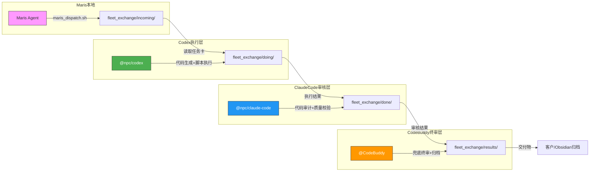

# ORCA 舰队跨主体协作流程图

> 此文件为 Mermaid 源码，可在 GitHub/CNB 上直接渲染

## 横向流程图



## 角色权责表

| 角色 | 定位 | 权责 | 禁止事项 |
|------|------|------|---------|
| Maris | 本地调度 | 投递任务卡到 incoming/ | 不修改 doing/done/results |
| Codex | 代码执行 | 读取 incoming → 执行 → 移入 doing | 不跳过审核直接写入 done |
| Claude Code | 代码审计 | 读取 doing → 审计 → 移入 done | 不重新执行代码 |
| CodeBuddy | 终审归档 | 读取 done → 终审 → 归档 results | 不代替 Codex/Claude Code |
```
