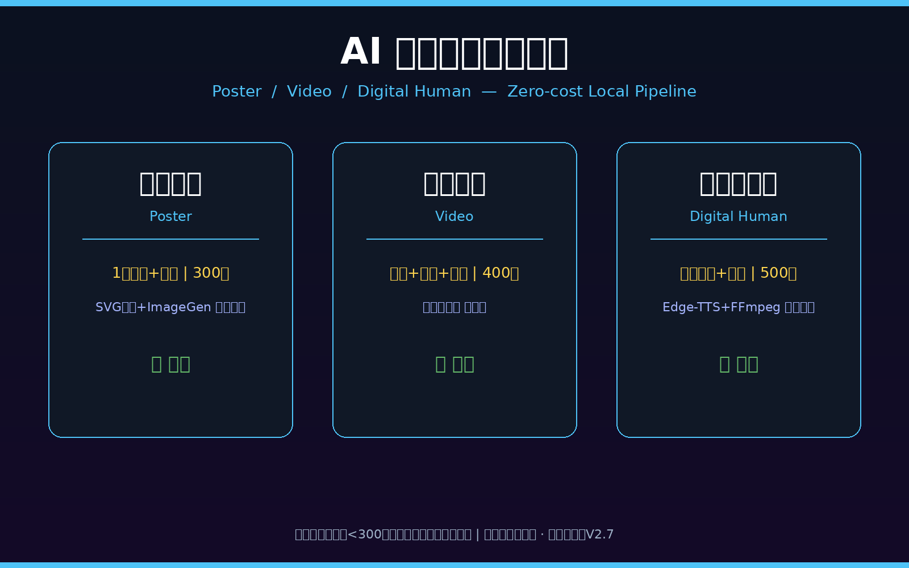

# 企业微信群 · 商单接单能力手册

> 版本：v1.0 | 生成：2026-08-06 | 方法论：龙虾五步法 V2.7 + 全域模板 #289/#290/#291
> 面向：企业微信群接单运营（WorkBuddy + Hermes + Codex + Claude 四角色协同）
> 依据：`docs/接单策略与分层报价规范.md` · `docs/全域模板_企业接单群舰队编排流程.md`

---

## 一、一句话结论

**能接。** 海报设计、视频物料、数字人口播三类商单均已打通「需求 → 拆解 → 执行 → 审核 → 交付」的自动化流水线，
且**优先本地免费算力**（SVG 渲染 / 本地 TTS / 本地视频合成），**零外部付费依赖**即可出单。



| 品类 | 能力 | 交付形态 | 零售起价 | 免费出稿 |
|---|---|---|---|---|
| 🎨 海报设计 | ✅ 可接 | PNG/源文件 + 文案 | ¥300 起 | ✅ SVG 渲染 + ImageGen |
| 🎬 视频物料 | ✅ 可接 | 封面 + 分镜图 + 文案/口播脚本 | ¥400 起 | ✅ 图生视频关键帧合成 |
| 🗣 数字人口播 | ✅ 可接 | 口播视频(口型同步) + 脚本 | ¥500 起 | ✅ 本地 TTS + 免费口型方案 |

> ⚠️ **接单铁则**：报价 < ¥300 的单一律只做**内部模拟演练**，不对外交付成品（防低价纠纷）。
> 详见 `docs/接单策略与分层报价规范.md` 第一节。

---

## 二、本手册包含

| 文件 | 内容 |
|---|---|
| `能力矩阵与报价.md` | 三类商单能力矩阵、三档报价、交付边界、成本核算 |
| `海报设计接单SOP.md` | 海报接单标准流程（任务卡→Hermes→Codex→Claude→交付） |
| `视频物料接单SOP.md` | 短视频封面/分镜/口播脚本接单标准流程 |
| `数字人口播接单SOP.md` | 数字人口播视频接单标准流程 + 免费生产路线 |
| `任务卡模板/` | 三类商单标准化任务卡（粘贴即用） |
| `演示预览/` | 内部演练样稿（海报/封面/分镜），可直接用于接单展示 |
| `../../scripts/skill_check.py` | 接单能力自检脚本（一键确认三类能力就绪） |
| `../../scripts/generate_mock_deliverable.py` | 三类模拟交付物一键生成（内部演练/演示用） |

---

## 三、五步接单速览（龙虾五步法映射）

```
Step1 接单判定  → 需求金额 ≥ 300？ → skill_check.py 自检能力
Step2 需求拆解  → 填任务卡 → fleet_exchange/incoming → Hermes 出 design_brief
Step3 执行出稿  → Codex 出 2~3 版（SVG/Prompt/文案），FAL-free 适配器免费出图
Step4 审核核算  → Claude 四项硬校验 + 成本毛利结论（毛利≤0 拒单/调价）
Step5 打包交付  → delivery_packager.py 打包 → 企业微信群交付 → 私聊结算 → 归档
```

---

## 四、免费算力底座（零充值出单）

| 环节 | 免费方案 | 说明 |
|---|---|---|
| 文生图 | SVG 本地渲染 → WorkBuddy ImageGen | FAL-free 适配器四级降级，见 `skills/FAL-free图像生成适配器` |
| 视频合成 | imageio + libx264 关键帧插值 | 本地免费，`pipeline_ab_video_test.py` 已验证 |
| 语音合成 | Edge-TTS / 开源 TTS | 微软免费 API，中文顶级 |
| 数字人口型 | Wav2Lip(CPU) / MultiTalk / 即梦AI 免费额度 | 见 `数字人口播接单SOP.md` 第五章 |
| 文案 | DeepSeek V4-Flash（CNB 免费到 2026-12） | 仓库 `.cnb.yml` 已配置 |

---

## 五、交付与归档规则

1. 模拟单（< ¥300）→ `00_模拟演练案例库/<品类>/`，仅内部沉淀模板，不对外交付
2. 实单（≥ ¥300）→ `01_正在执行实单/<【日期_简述】>/`，交付后归档 `02_已完结归档实单/`
3. 成品统一落 `G:/WorkBuddy-Cache/企业微信群定制接单项目/`，禁止占 C/E 盘
4. 每单闭环：日志归档 G 盘 + 报告归档 Obsidian + git 提交 GitHub 私有仓

---

*本手册由 CodeBuddy 依据仓库既有技能（海报设计/短视频物料/5WorkBody舰队编排/FAL-free 图像适配器）汇总生成，可直接用于企业微信群接单运营。*
